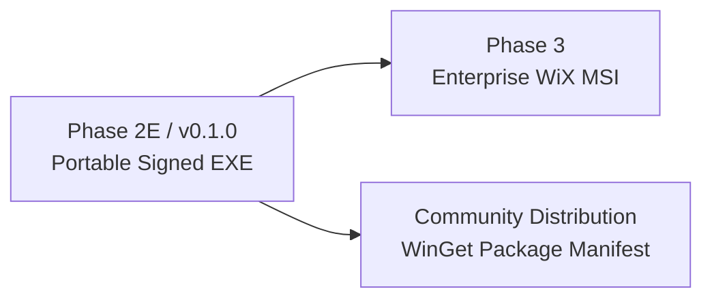

# RansomEye Distribution Channel Evaluation & Decision — Phase 2E

**Date:** October 26, 2026  
**Auditor:** Senior Windows Software Release Engineer & DFIR Product Architect  
**Target Repository:** `D:\nira\project\RansomEye`  
**Target Artifact:** `RansomEye.exe` (Standalone Windows Executable)

---

## 1. Executive Summary & Recommendation

RansomEye is a Digital Forensics and Incident Response (DFIR) platform designed to be deployed during active ransomware investigations, live forensic triage, or post-incident analysis.

### Primary Recommendation: **Channel 1 — Portable Windows Executable (Self-Contained Triage Edition)**
For the initial release (v0.1.0 / Phase 2E milestone), RansomEye should be distributed primarily as a **standalone, portable Windows executable** (`RansomEye.exe`), accompanied by a SHA-256 manifest and an Authenticode digital signature.

### Secondary Roadmap Recommendation: **Channel 2 — WiX Enterprise MSI Installer**
Following stabilization of the standalone executable, an enterprise `.msi` installer should be introduced in Phase 3 for organizations seeking permanent installation in `%ProgramFiles%\RansomEye`, automated PATH registration, and continuous background collector deployment via Windows Service or Scheduled Task.

---

## 2. Comparative Channel Evaluation

| Evaluation Criteria | Channel 1: Portable Executable | Channel 2: Enterprise Installer (WiX / Inno Setup) | Channel 3: MSIX / Microsoft Store |
| :--- | :--- | :--- | :--- |
| **Packaging Artifact** | Single `.exe` (~20.1 MB) | Windows Installer package (`.msi` / `.exe`) | App package (`.msix` / `.appxbundle`) |
| **Installation Footprint** | Zero filesystem footprint outside working directory | `%ProgramFiles%\RansomEye`, registry entries, Start Menu shortcuts | `%ProgramFiles%\WindowsApps` (isolated container) |
| **Administrative Privileges** | **Not Required** for static, script, PCAP, or reporting triage. (Elevated admin required only for live kernel/memory collectors) | **Required** for standard `%ProgramFiles%` install | **Not Required** for user-mode install via Store / App Installer |
| **DFIR Field Usability** | **Optimal**: Can be executed directly from a write-blocked USB drive, incident response thumbdrive, or network share | **Poor for Triage**: Requires running an installation wizard on compromised evidence endpoints | **Unacceptable for Triage**: Requires internet connectivity, Microsoft account, or Store enablement |
| **Filesystem & Database Access** | Direct access to arbitrary forensic evidence paths and SQLite databases | Direct access to system paths | Containerized filesystem redirection; virtualized registry; access to external arbitrary paths requires capability declarations |
| **SmartScreen & Trust** | Subject to SmartScreen warning until signed with EV or Azure Trusted Signing | Subject to SmartScreen warning until signed | Store ingestion automatically signs binary with Microsoft Store certificate; side-loading requires trusted enterprise CA |
| **Auto-Update Mechanism** | Manual download / GitHub release replacement | Enterprise GPO / SCCM / Intune deployment or WinGet | Native background updates via Windows Store / App Installer |

---

## 3. Detailed Channel Breakdown

### 3.1 Channel 1: Portable Windows Executable (Recommended First Release)
- **Use Case:** Emergency DFIR triage, malware analysis lab environments, incident responder "jump bags", air-gapped forensic workstations.
- **Advantages:**
  1. *Immediate Execution:* Zero installation overhead on potentially unstable or compromised host systems.
  2. *Forensic Containment:* Does not modify system registry keys, create unneeded Windows event providers, or pollute the endpoint's `%ProgramFiles%`.
  3. *Portability:* Runs seamlessly from read-only media or analyst staging directories.
  4. *Clean-Machine Ready:* Verified in Phase 2D/2E to execute on clean Windows systems with zero Python runtime dependencies.
- **Trade-offs & Mitigations:**
  - *SmartScreen Prompts:* Unsigned binaries will display an "Unknown Publisher" block. *Mitigation:* Mandate Authenticode signing prior to release.
  - *PATH Registration:* The user must invoke the binary by full path or add the folder to their user `PATH`. *Mitigation:* Clear documentation in release README.

### 3.2 Channel 2: Enterprise MSI Installer (Recommended Phase 3)
- **Use Case:** SOC workstations, corporate forensic jump servers, endpoints configured for continuous telemetry and canary file monitoring.
- **Tooling:** **WiX Toolset v4/v5** (producing native Windows Installer `.msi` packages).
- **Advantages:**
  1. Integrates with Microsoft Intune, Group Policy Objects (GPO), and SCCM for centralized silent fleet deployment (`msiexec /i RansomEye.msi /qn`).
  2. Creates standard `%ProgramFiles%\RansomEye` directory with appropriate Windows DACLs (restricting non-administrators from tampering with binaries).
  3. Automatically registers `ransomeye` in system `PATH`.
  4. Can register Windows background services or Scheduled Tasks for continuous file and network collectors.
- **Trade-offs:**
  - Introduces complex uninstallation and upgrade logic (`MajorUpgrade` rules, registry cleanup).
  - Unsuited for incident response triage on target machines where software installation is forbidden.

### 3.3 Channel 3: MSIX and Microsoft Store (Evaluated & Deferred)
- **Official References:**
  - [Microsoft Learn: Package a desktop application using Desktop Bridge (MSIX)](https://learn.microsoft.com/en-us/windows/msix/desktop/desktop-to-uwp-root)
  - [Microsoft Learn: App Execution Alias (`windows.appExecutionAlias`)](https://learn.microsoft.com/en-us/uwp/schemas/appxpackage/uapmanifestschema/element-uap5-appexecutionalias)
- **Technical Capabilities:**
  - Supports CLI tools using `<uap5:Extension Category="windows.appExecutionAlias">` with `<uap5:ExecutionAlias Alias="ransomeye.exe" />` and `<uap:VisualElements AppListEntry="none" />` for Windows 10 build 1809+.
- **Why MSIX is Inadvisable for RansomEye Initial Release:**
  1. *VFS Virtualization:* MSIX enforces virtualized file systems (`VFS`) and registry redirection. Forensic tools that analyze raw drive sectors, access protected Volume Shadow Copies (`vssadmin`), or inspect Sysmon event logs encounter friction with MSIX sandbox boundaries.
  2. *Store Certification Policy:* Microsoft Store policies heavily restrict tools categorized as security assessment or penetration testing utilities.
  3. *Air-Gapped Incompatibility:* Store deployment is impossible in isolated SOC enclaves or air-gapped lab networks without manual enterprise sideloading certificates.

---

## 4. Release Decision & Staging Plan

1. **Phase 2E Distribution Target:** Release `RansomEye-v0.1.0-win64.zip` containing:
   - `RansomEye.exe` (Signed single-file executable)
   - `THIRD_PARTY_NOTICES.md`
   - `README.md` (CLI syntax and analyst console guide)
   - `release_manifest.json` (Cryptographic verification hashes)
2. **Phase 3 Follow-up:** Implement WiX `.msi` project in `packaging/wix/` for automated enterprise endpoint deployment.
3. **WinGet Submission:** Publish a community package manifest to the Windows Package Manager repository (`winget install RansomEye.RansomEye`).
